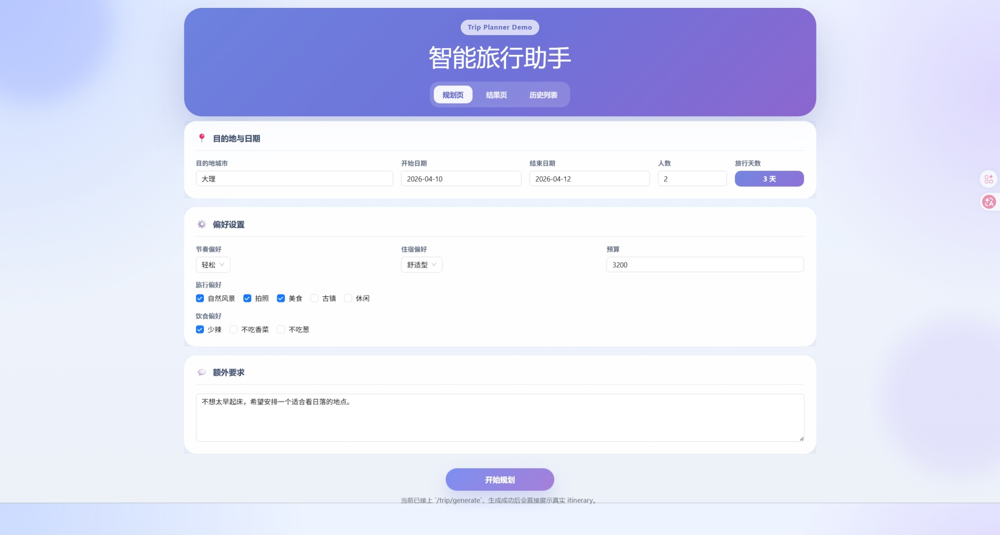
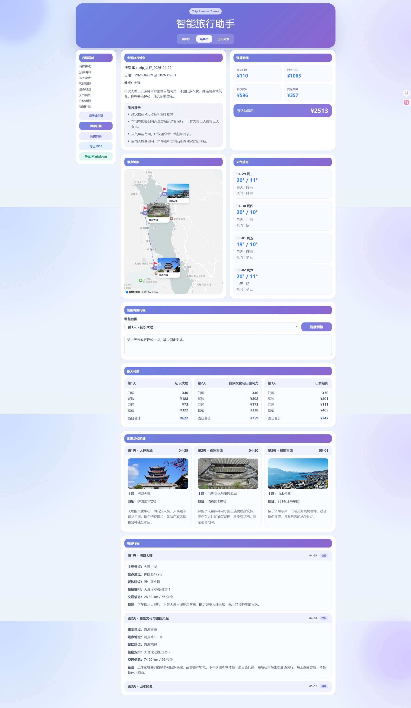
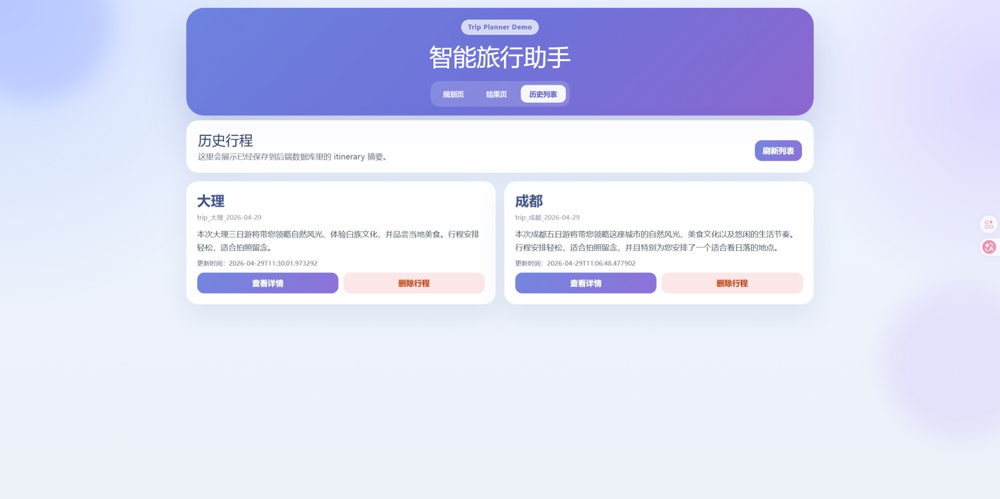
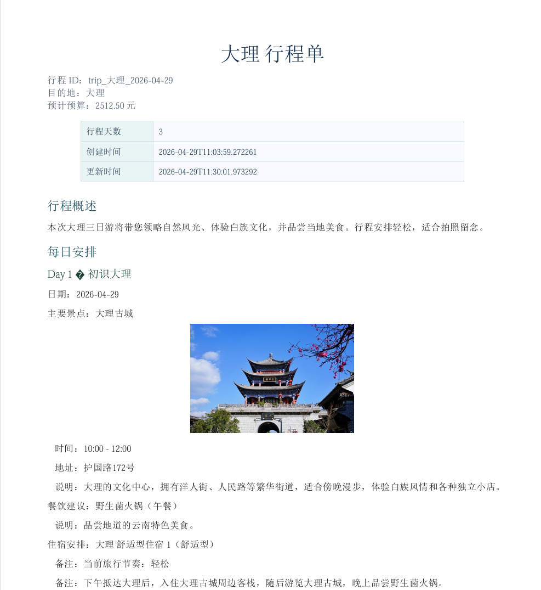
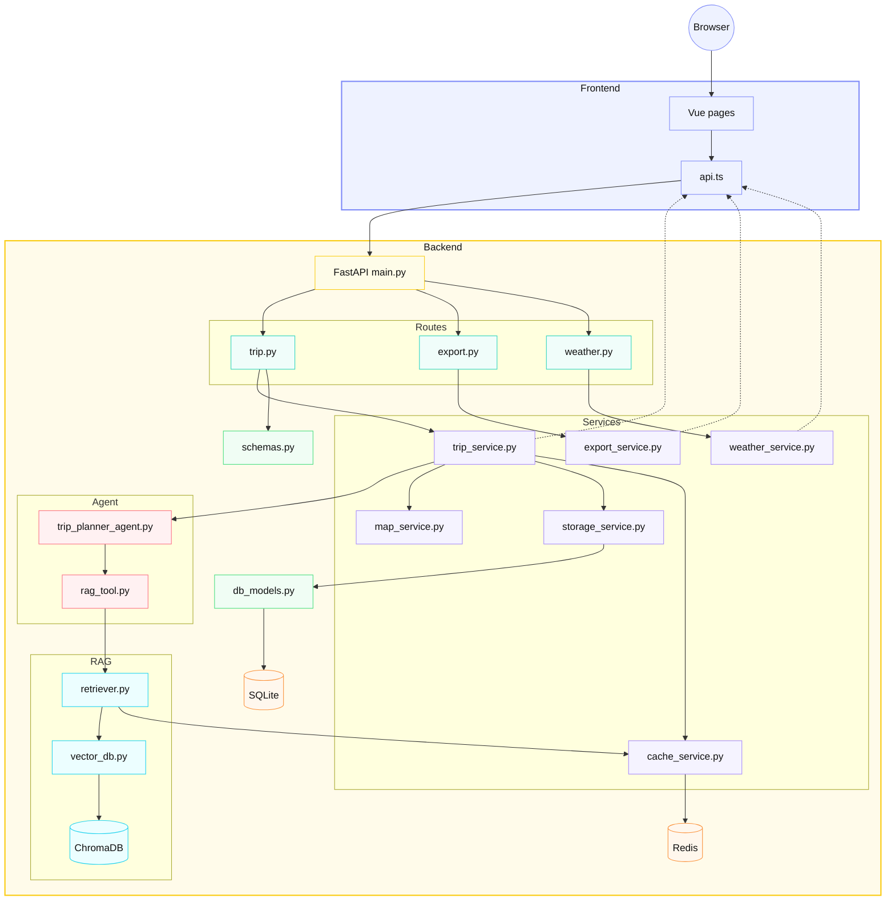
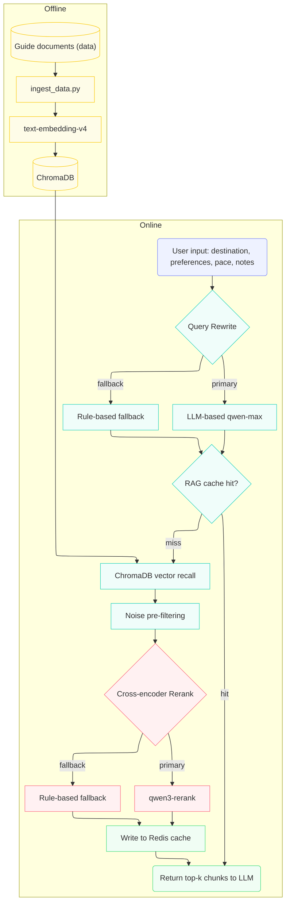
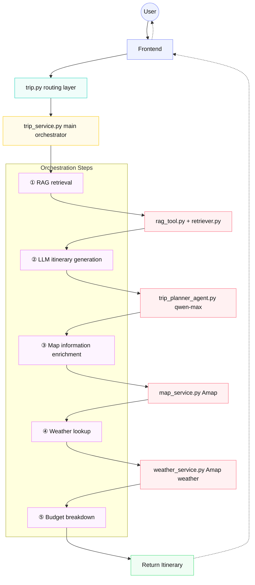

# 🗺️ Zhilv Yuntu (Smart Travel Atlas)

> An intelligent travel planning system combining LLMs, RAG, local travel guides, and Amap (Gaode Maps) capabilities

Zhilv Yuntu is an AI travel-planning project built for Chinese travel scenarios. After a user enters a destination, dates, budget, group size, and preferences, the system automatically generates a structured travel plan and further enriches it with map locations, weather information, budget breakdowns, attraction images, and exportable travel documents.

Compared to an LLM demo that just outputs a block of text, this project puts more emphasis on shipping a complete pipeline: from **itinerary generation, guide retrieval, map information enrichment, and weather integration, to history management and document export**, the goal is to organize AI capability into an interactive, saveable, presentable product prototype.

## 📝 Recent Updates

- `2026-06-11`
  - Deployment: added a Docker Compose containerized deployment setup — backend (FastAPI), frontend (Nginx), and Redis orchestrated as three containers, launched with a single `docker compose up`.
  - Frontend: Nginx reverse proxy unifies the frontend/backend entry point; a two-stage build optimizes image size.
- `2026-05-19`
  - Engineering observability: added token consumption tracking, covering the Query Rewrite, Query Embedding, qwen3-rerank, and Planner generation pipeline, with a per-item and total breakdown printed to the backend terminal.
  - API: `/trip/generate` now returns a `token_usage` field, and `/trip/stats` supports aggregating token consumption across saved itineraries.
- `2026-05-07`
  - RAG: completed Cross-encoder Rerank (qwen3-rerank) + noise pre-filtering; Top-1 hit rate improved from 86.7% → 93.3%, MRR from 0.922 → 0.967.
  - RAG: added a Rerank cache; average latency dropped from 728ms to 425ms after a cache hit, a 41.6% reduction.
- `2026-05-06`
  - RAG: refined the evaluation metric system, adding four quantitative metrics — MRR, Noise Rate, Latency, and Cross-destination Pollution.
  - RAG: implemented LLM-based Query Rewrite, replacing hand-written rule-based query rewriting with qwen-max; Top-1 hit rate improved from 80% → 86.7%, MRR from 0.889 → 0.922.
- `2026-04-29`
  - RAG: expanded the knowledge base to 5 destinations (Dali / Chengdu / Xi'an / Xiamen / Sanya), expanded the evaluation sample set to 15 cases, and implemented multi-tier rule-based rerank downweighting plus destination filtering in Query Rewrite to eliminate cross-destination pollution.
  - Map frontend: added dashed-arrow route visualization on the map, 🚩 flag check-in markers, and attraction image popup bubbles.
- `2026-04-25`: completed the first round of RAG online-stage optimization, integrating lightweight Query Rewrite, lightweight Rerank, and a retrieval debugging script.
- `2026-04-15`: added a Redis caching layer, covering weather queries, map queries, and RAG retrieval result caching.

More updates: [CHANGELOG.md](./CHANGELOG.md)


---

## 📸 Showcase

### Planning page



### Itinerary generation result page



### Save & history management



### PDF export result



---

## ✨ Highlights

- 🧠 **LLM itinerary generation**: uses LangChain + DashScope to call `qwen-max` and generate a structured travel plan
- 📚 **RAG-enhanced travel guides**
  - Local Markdown guides + Chroma vector retrieval enrich generated results with destination-specific context
  - The online stage continuously improves retrieval quality via LLM-based Query Rewrite + Cross-encoder Rerank (qwen3-rerank) + noise pre-filtering, reaching a 93.3% Top-1 hit rate and an MRR of 0.967
- 🗺️ **Amap integration**: enriches addresses, coordinates, POI IDs, route distances, travel times, and attraction images, with dashed-arrow route visualization and 🚩 check-in markers
- 🌦️ **Weather-aware prompts**: the frontend displays weather forecasts and automatically adjusts travel tips based on rain/overcast conditions
- ⚡ **Redis caching layer**: covers weather, map, RAG retrieval, and rerank result caching, reducing redundant external API calls
- 📊 **Token consumption tracking**: tracks input/output tokens separately for Query Rewrite, Query Embedding, Rerank, and Planner, and returns totals in both backend logs and API responses
- 💰 **Budget breakdown**: splits costs across transportation, lodging, dining, admission, and other expenses, with a day-by-day view
- 🪄 **Smart editing**: lets users adjust a single day's itinerary using natural language
- 🗂️ **History management**: supports saving, viewing, opening, and deleting past itineraries
- 📄 **Document export**: supports Markdown and Chinese-language PDF export, automatically syncing the current page's data before export
- 🖥️ **Frontend visualization**: provides planning, result, and history pages, delivering a complete core business workflow

---

## 🏗️ Technical Architecture

### Tech Stack

- Backend: FastAPI + Pydantic + SQLAlchemy
- LLM: LangChain + DashScope (`qwen-max`)
- Vector store: ChromaDB
- Cache: Redis
- External services: HTTPX + Amap Web Service + Amap JavaScript API
- Frontend: Vue 3 + Vite
- Database: SQLite

### Core Architecture Layers

| Layer | Key files | Responsibility |
| :--- | :--- | :--- |
| Frontend | `frontend/src/views/*.vue` | Display and interaction for the planning, result, and history pages |
| API layer | `backend/app/api/routes/` | trip, export, and weather routes |
| Service layer | `backend/app/services/` | Itinerary orchestration, map enrichment, weather, caching, export, storage |
| Agent layer | `backend/app/agents/` | LLM itinerary generation + LLM-based Query Rewrite |
| RAG layer | `backend/app/rag/` | Vector ingestion, retrieval, Cross-encoder Rerank |
| Data layer | `backend/data/` | Local Markdown travel guide documents |

### System Data Flow



Data flow: the frontend collects user input → the backend calls the LLM + RAG to generate a structured itinerary → the map service enriches it with addresses, coordinates, routes, and images → the frontend displays the map, weather, budget, and daily itinerary → the user can save, edit, view history, and export documents.

### Data Storage & Cache Division of Labor

The project separates long-lived business data from short-lived, high-frequency query results:

- **SQLite: persistent storage**
  - Implementation: `backend/app/config.py`, `backend/app/models/db_models.py`, `backend/app/services/storage_service.py`
  - Use case: stores the complete travel plan after generation, and supports listing history, viewing details, deleting, and Markdown/PDF export.
  - Storage approach: a `TripRecord` table is defined via SQLAlchemy, with core fields including `trip_id`, `destination`, `summary`, `itinerary_json`, `created_at`, and `updated_at`.
  - Rationale: a travel plan is business data the user actively chose to save, which needs to be retained long-term, queryable, and deletable; SQLite is used at this stage for lightweight deployment, suitable for a personal project or demo scenario.

- **Redis: cache acceleration**
  - Implementation: `backend/app/services/cache_service.py`, reused by `weather_service.py`, `map_service.py`, and `retriever.py`.
  - Use case: caches weather queries, Amap geocoding/POI/route results, RAG retrieval results, and qwen3-rerank reranking results.
  - Storage approach: business modules generate a cache key, `cache_service.py` uniformly prefixes it with `trip_planner`, serializes Python `dict`/`list` objects to a JSON string, writes it to Redis, and sets a TTL for automatic expiration.
  - Rationale: weather, map, and RAG/Rerank results show clear repeat-query patterns and remain relatively stable over short periods; using Redis reduces external API calls and repeated retrieval overhead, improving API response speed and stability.

In short: **SQLite stores "the itinerary data users want to keep," and Redis stores "intermediate query results that can be reused in the short term."**

### RAG Retrieval Pipeline



**Offline stage**

```text
Local Markdown guides → chunked by heading (49 chunks) → converted to vectors via text-embedding-v4 → written to ChromaDB
```

This step runs only once; once the data is ingested, it isn't touched again.

**Online stage**

```text
User input (destination / preferences / pace / notes)
    ↓
① Query Rewrite (LLM-based / rule-based fallback)
    Output: retrieval keywords, e.g. "Dali food photography old town Erhai Lake"
    ↓
② Embedding (same text-embedding-v4 model)
    Converts the retrieval keywords into a vector so similarity can be computed against the document vectors in ChromaDB
    ↓
③ Vector recall (ChromaDB)
    Uses vector similarity to find the top-6 candidate chunks
    ↓
④ Noise pre-filtering
    Removes low-information chunks such as "document headers" to avoid wasting rerank API calls
    ↓
⑤ Cross-encoder Rerank (qwen3-rerank / rule-based fallback)
    Semantic-level reranking, selecting the top-3 most relevant chunks
    ↓
⑥ Write to Redis cache
    RAG cache: query → top-k text
    Rerank cache: query + candidate hash → ranking scores
    ↓
⑦ Return top-k text to the LLM
    Assembled into a prompt together with user information, and passed to qwen-max to generate the itinerary
```

---

## 📁 Project Structure

```text
TripPlannerDemo/
├── backend/
│   ├── app/
│   │   ├── config.py          # Environment variables, database Base, global config
│   │   ├── agents/
│   │   │   ├── trip_planner_agent.py    # LLM itinerary generation and single-day edit logic
│   │   │   └── tools/
│   │   │       └── rag_tool.py          # Query Rewrite: LLM-based rewriting + rule-based fallback
│   │   ├── api/
│   │   │   ├── main.py                  # FastAPI application entry point
│   │   │   └── routes/
│   │   │       ├── trip.py              # Generate, edit, save, query, and delete endpoints
│   │   │       ├── export.py            # Markdown / PDF export endpoints
│   │   │       └── weather.py           # Weather forecast endpoint
│   │   ├── models/
│   │   │   ├── schemas.py               # Pydantic request/response/itinerary models
│   │   │   └── db_models.py             # SQLAlchemy database table definitions
│   │   ├── rag/
│   │   │   ├── vector_db.py             # Markdown chunking, Chroma ingestion and retrieval
│   │   │   └── retriever.py             # Retrieval wrapper, RAG cache, Cross-encoder Rerank + rule-based fallback
│   │   └── services/
│   │       ├── trip_service.py          # Main itinerary orchestration logic, budget calculation, map enrichment
│   │       ├── cache_service.py         # Redis cache wrapper and degradation logic
│   │       ├── map_service.py           # Amap POI, geocoding, route, and image enrichment
│   │       ├── weather_service.py       # Amap weather service wrapper
│   │       ├── storage_service.py       # SQLite save, query, list, and delete
│   │       └── export_service.py        # Markdown / PDF rendering and export
│   ├── data/                  # Local travel guide documents
│   ├── eval/                  # RAG retrieval evaluation sample set
│   ├── scripts/                # ingest, map validation, RAG debugging and evaluation scripts
│   ├── tests/                  # pytest tests
│   ├── Dockerfile             # Backend container packaging config
│   ├── .dockerignore          # Docker build exclusion rules
│   ├── .env.example           # Backend environment variable template
│   └── requirements.txt
├── frontend/
│   ├── src/
│   │   ├── services/
│   │   │   └── api.ts                   # Axios wrapper and frontend API calls
│   │   ├── types/
│   │   │   └── index.ts                 # TypeScript data type definitions
│   │   ├── views/
│   │   │   ├── Home.vue                 # Planning page
│   │   │   ├── Result.vue               # Result display page
│   │   │   └── History.vue              # History list page
│   │   ├── components/
│   │   │   └── AmapTripMap.vue          # Map display component
│   │   ├── App.vue                      # Page-switching entry point
│   │   └── main.ts                      # Frontend entry point
│   ├── Dockerfile             # Frontend two-stage build (Node compile → Nginx hosting)
│   ├── nginx.conf             # Nginx config (static files + API reverse proxy)
│   ├── .dockerignore          # Docker build exclusion rules
│   ├── .env.example           # Frontend environment variable template
│   └── package.json
├── docker-compose.yaml        # Service orchestration (backend + frontend + Redis)
├── assets/
│   └── showcase/              # README showcase screenshots
├── CHANGELOG.md               # Project feature and architecture changelog
├── .gitignore
└── README.md
```

> `docs/` is a local development and interview-prep documentation directory, ignored by `.gitignore` by default and not pushed to GitHub.

### Key File Responsibilities

**Backend**

- `backend/app/services/trip_service.py`
  Orchestrates the main itinerary pipeline, including day-by-day splitting, budget estimation, map enrichment, and unified refresh after edits.
- `backend/app/services/cache_service.py`
  Lazy-loaded Redis client, JSON cache read/write, and graceful degradation when Redis is unavailable.
- `backend/app/agents/trip_planner_agent.py`
  Calls the LLM to generate a structured travel draft, and handles LLM output for single-day edits.
- `backend/app/agents/tools/rag_tool.py`
  Query Rewrite for the RAG online stage — prioritizes LLM-based rewriting (qwen-max), falling back to rule-based keyword extraction.
- `backend/app/rag/retriever.py`
  Wraps vector recall results, RAG caching, Cross-encoder Rerank (qwen3-rerank) + rerank caching, falling back to rule-based scoring.
- `backend/app/services/map_service.py`
  Integrates with the Amap Web Service, combined with Redis caching, to enrich addresses, coordinates, route estimates, and attraction images.
- `backend/app/services/export_service.py`
  Renders the itinerary as Markdown and Chinese-language PDF.
- `backend/app/services/storage_service.py`
  Handles SQLite data saving, reading, history listing, and deletion.
- `backend/scripts/debug_rag_retrieval.py`
  Debugs the RAG online stage, outputting the retrieval query, top-k recalled chunks, `rerank_score`, and `rerank_reasons`.
- `backend/scripts/evaluate_rag_retrieval.py`
  Evaluates RAG retrieval performance, outputting Top1/TopK hit rate, MRR, Noise Rate, Latency, and cross-destination pollution metrics.
- `backend/eval/rag_eval_cases.json`
  RAG retrieval evaluation sample set, used to compare performance before and after optimization.

**Frontend**

- `frontend/src/services/api.ts`
  Axios wrapper for backend API communication.
- `frontend/src/views/Home.vue`
  Planning page — collects user input and initiates the itinerary generation request.
- `frontend/src/views/Result.vue`
  Result display page — hosts the itinerary, map, weather, and export interactions.
- `frontend/src/views/History.vue`
  History list page — supports viewing, opening, and deleting past itineraries.
- `frontend/src/components/AmapTripMap.vue`
  Amap map component — displays route visualization and attraction markers.

---

## 📡 Core API

| Method | Path | Description |
| :--- | :--- | :--- |
| `GET` | `/` | Service startup check |
| `GET` | `/health` | Health check |
| `POST` | `/trip/generate` | Generate an itinerary |
| `GET` | `/trip/stats` | Query token consumption stats for saved itineraries |
| `POST` | `/trip/edit` | Smart-edit an itinerary |
| `POST` | `/trip/save` | Save an itinerary |
| `GET` | `/trip` | List history |
| `GET` | `/trip/{trip_id}` | Itinerary details |
| `DELETE` | `/trip/{trip_id}` | Delete an itinerary |
| `GET` | `/export/{trip_id}/markdown` | Export as Markdown |
| `GET` | `/export/{trip_id}/pdf` | Export as PDF |
| `GET` | `/weather/forecast` | Query weather |

---

## 🔄 Key Business Flows

### Explicit Orchestration Workflow

The project organizes its business flow using explicit orchestration (rather than autonomous agent decision-making) — each step is called by `trip_service.py` in a fixed order, which fits a scenario where the business logic is deterministic and the steps are predictable.



### Itinerary Generation

```text
POST /trip/generate
  -> trip.py (routing layer)
    -> trip_service.py (main orchestrator)
      -> ① rag_tool.py
           Query Rewrite (LLM-based / rule-based fallback)
           -> retriever.py
               RAG cache check
               -> ChromaDB vector recall
               -> Noise pre-filtering
               -> Cross-encoder Rerank (cache -> API -> rule-based fallback)
      -> ② trip_planner_agent.py
           Assembles the prompt (user input + RAG context)
           -> qwen-max generates the structured itinerary
           -> Pydantic validates the output
      -> ③ map_service.py (per attraction)
           Geocoding -> POI search -> route estimation -> image enrichment
           (each step has Redis caching)
      -> ④ weather_service.py
           Weather forecast lookup (Redis cache)
      -> ⑤ Budget breakdown calculation
      -> ⑥ Records token_usage (Query Rewrite / Query Embedding / Rerank / Planner / Total)
      -> Returns the Itinerary
```

### Smart Editing

```text
POST /trip/edit
  -> trip.py (routing layer)
    -> trip_service.py (main orchestrator)
      -> ① Locates the target DayPlan (resolves day_index from edit_scope)
      -> ② trip_planner_agent.py
           generate_day_edit_draft (LLM generates the single-day edit)
           -> falls back to rule-based editing (keyword matching) on failure
      -> ③ Replaces the target DayPlan (theme / spots / meals / notes)
      -> ④ map_service.py re-enriches (clears stale coordinates, re-queries)
      -> ⑤ Updates tips and source_notes
      -> Returns the updated Itinerary
```

### Save & Export

```text
POST /trip/save
  -> storage_service.py -> SQLite persistence

GET /export/{trip_id}/markdown
  -> storage_service.py reads the itinerary
  -> export_service.py -> renders Markdown via Jinja2

GET /export/{trip_id}/pdf
  -> storage_service.py reads the itinerary
  -> export_service.py -> generates a Chinese-language PDF via ReportLab
  -> Content-Disposition returns the download filename (RFC-encoded for Chinese-character compatibility)
```

---

## ✅ Current Completion Status

- ✅ **Backend capabilities**: itinerary generation, smart editing, save/query, history listing, deletion, weather lookup, Markdown export, and PDF export endpoints
- ✅ **AI and data capabilities**: LangChain itinerary generation pipeline, RAG retrieval over 5 destinations' travel guides, Chroma ingestion and retrieval, Amap address/coordinate/route/image enrichment
- ✅ **RAG online optimization**: LLM-based Query Rewrite + Cross-encoder Rerank (qwen3-rerank) + noise pre-filtering + rerank caching, a retrieval debugging script with a 15-case evaluation sample set, and a quantitative evaluation metric system (Top1/TopK hit rate, MRR, Noise Rate, Latency, Cross-destination Pollution)
- ✅ **Token observability**: `/trip/generate` returns per-item token consumption for Query Rewrite, Query Embedding, Rerank, and Planner for that request, with prompt/completion/total printed to the backend terminal in sync, and `/trip/stats` aggregates token stats across saved itineraries
- ✅ **Frontend capabilities**: planning, result, and history list pages, plus map/weather/budget display, export, and history management as the main workflow
- ✅ **Caching and persistence**: SQLite persistent storage + Redis caching layer (covering weather, map, RAG retrieval, and rerank results)
- ✅ **Validation status**: the core pipeline runs reliably end-to-end; Redis cache keys have been verified to write correctly in a local container

---

## 🌱 Future Directions

- ✅ **Caching and engineering maturity**
  The Redis caching layer is complete, covering weather queries, map queries, RAG retrieval results, and rerank result caching; future work could extend this to session-state management, hot-destination reuse, and finer-grained cache hit-rate statistics.
- ✅ **RAG retrieval enhancements**
  - ✅ Rule-based Query Rewrite → LLM-based Query Rewrite (qwen-max), Top-1 hit rate 80% → 86.7%, MRR 0.889 → 0.922.
  - ✅ Rule-based Rerank → Cross-encoder Rerank (qwen3-rerank) + noise pre-filtering + rerank caching, Top-1 hit rate 86.7% → 93.3%, MRR 0.922 → 0.967.
  - ✅ Knowledge base expanded to 5 destinations, a 15-case evaluation sample set, and a complete quantitative evaluation metric system.
- 🚧 **Token cost analysis dashboard**
  Backend token statistics and the `/trip/stats` aggregation endpoint are complete; a future frontend cost analysis panel could compare token consumption, latency, and generation quality across different RAG strategies.
- 🚧 **Retrieval result compression and de-duplication**
  Recalled RAG chunks may contain duplicate or redundant information; compressing and de-duplicating them before feeding them to the LLM would reduce token consumption and improve generation quality.
- 🚧 **Hybrid retrieval (vector + BM25)**
  Currently only vector retrieval is used; adding BM25 keyword retrieval and fusing the rankings with RRF (Reciprocal Rank Fusion) would cover both semantic similarity and exact keyword matching.
- 🚧 **PDF export improvements**
  The current PDF has relatively low readability; future work could improve the layout (columns, card-style layout), Chinese fonts, embedded attraction images, weather icons, and route diagrams to produce an export closer to a travel-guidebook style.
- 🚧 **Expanded knowledge base sources**
  Could integrate travel posts from social platforms like Xiaohongshu, using multimodal parsing (image/text extraction, structured summarization) to convert real travel journals into local knowledge base material, filling gaps that official guides don't cover with practical, real-world tips.
- 🚧 **LangGraph workflow**
  The project currently relies mainly on linear LangChain orchestration; future work could introduce LangGraph to organize generation, retrieval, map enrichment, weather integration, editing, and export as a state machine, supporting conditional branching and parallel execution; a further step could introduce LLM-based intent recognition routing, so the system first classifies the user's request type before dispatching to the corresponding processing chain.
- 🚧 **Real merchant information display**
  Integrate real dining and hotel/lodging data from the backend (e.g. Amap POI details, Dianping, etc.), normalized into structured data (name, address, rating, average spend, images, etc.), displayed as cards on the frontend to improve the itinerary's practicality and credibility.
- 🚧 **External tools and MCP-ification**
  External capabilities like maps, weather, web search, and POI lookup could gradually be abstracted into an MCP tool layer, making them easier to reuse across different agents or workflows, while the main business orchestration stays in the service layer.
- 🚧 **GraphRAG**
  Use a graph structure to represent relationships between cities, attractions, routes, and thematic tags, enhancing multi-location recommendation and itinerary-consistency constraints.
- 🚧 **Web search augmentation**
  Could integrate web search capability to supplement attraction operating status, currently trending locations, holiday information, and real-time travel advisories, so the local-guide RAG and real-time information complement each other.
- 🚧 **Travel plan quality evaluation system**
  Build quantitative evaluation metrics for generated results — such as structural completeness, budget reasonableness, attraction coverage, weather consistency, and preference satisfaction — enabling end-to-end quality measurement.
- 🚧 **Performance and stability**
  Could add an asynchronous task queue, request rate limiting, failure retries, logging/tracing, and monitoring/alerting to improve stability in real deployment scenarios.
- 🚧 **Product feature expansion**
  Could continue to enhance mobile responsiveness, user login, multi-user isolation, itinerary comparison, and itinerary sharing.
